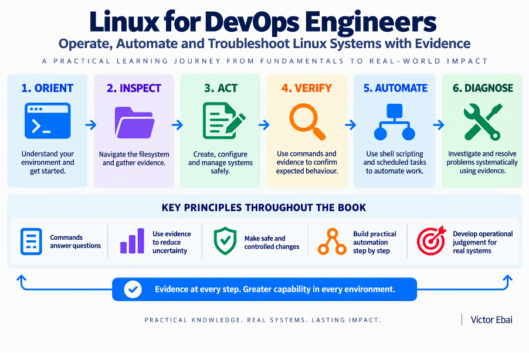

# Linux for DevOps Engineers

[](https://github.com/vebai/linux-for-devops-engineers/actions/workflows/validate.yml)

This is the companion repository for *Linux for DevOps Engineers: Operate, Automate and Troubleshoot Linux Systems with Evidence* by **Victor Ebai**. It provides chapter-by-chapter lab guides, sample configuration and log files, and a Bash script for verifying NGINX. The book is self-contained, and the repository gives you files you can run and inspect as you practise.

## Get the book on Amazon

<a id="get-the-paperback"></a>

**Paperback:** [Amazon UK](https://www.amazon.co.uk/dp/B0HNP5QTYW) · [Amazon US](https://www.amazon.com/dp/B0HNP5QTYW)

**Kindle eBook:** [Amazon UK](https://www.amazon.co.uk/dp/B0HNKDJPZ7) · [Amazon US](https://www.amazon.com/dp/B0HNKDJPZ7) · [Amazon India](https://www.amazon.in/dp/B0HNKDJPZ7)

**Quick navigation:** [Before you begin](#before-you-begin) · [Getting started](#getting-started) · [Chapter guide](#chapter-guide) · [Validation](#verify-the-repository-files) · [Cleanup](docs/CLEANUP.md)



*The labs progress from identifying the system you are working on to verifying recovery after a service failure.*

## What you will build and practise

- Build a continuous Linux lab in `~/devops-lab/` and organise its configuration, logs and scripts.
- Work with files, archives, ownership and permissions, and capture command output and errors for diagnosis.
- Install or inspect NGINX, read systemd journal entries, and trace a local HTTP request from the listening port to the response.
- Run a repeatable Bash verification check, diagnose a controlled NGINX failure, and verify recovery.

## Before you begin

<a id="prerequisites"></a>

- A disposable Linux VM you are authorised to administer. Use a recent Ubuntu/Debian or RHEL-family distribution with systemd, networking and working package repositories. Use Ubuntu for the live validation script.
- A non-root lab user with authorised `sudo` access for package installation and service management.
- Bash and Python 3 for the repository checks, Git to clone the examples, and curl for the HTTP exercises. The [setup guide](docs/SETUP.md) includes package installation and environment checks.

> [!WARNING]
> Run the service and permission drills only in an authorised disposable lab. Some exercises deliberately change file permissions or stop NGINX. Keep them off production systems and shared servers.

See [Create a Linux lab](docs/linux-lab-setup/README.md) for VirtualBox, VMware and WSL 2 instructions. On Windows, confirm that systemd is enabled and working before using WSL 2 for service exercises.

> [!NOTE]
> [GitHub Codespaces](https://docs.github.com/en/codespaces/about-codespaces/what-are-codespaces) opens a development container on a GitHub-managed VM. You can use it to browse the examples or run the static and mocked checks with Bash and Python 3 available. Service, journal and networking labs depend on the init system and network available inside the container. Use the disposable Linux VM for those labs and for live Ubuntu validation.

## Getting started

1. **Open a terminal in your disposable Linux lab.** Check the host and user, then clone the examples and verify your tools.

   ```bash
   hostname
   whoami
   cat /etc/os-release
   git clone https://github.com/vebai/linux-for-devops-engineers.git
   cd linux-for-devops-engineers
   bash --version
   python3 --version
   curl --version
   ```

   If Git is unavailable, download and extract the repository archive into your Linux home directory.

2. **Begin with [Chapter 1](chapters/chapter-01-operating-context/README.md).** Confirm your host, distribution and user, then create `~/devops-lab/` as instructed.
3. **Follow the chapters in order.** Keep the clone as a reference and make lab changes in `~/devops-lab/`. Copy files into it only when a chapter asks you to. For example, Chapter 10 uses `scripts/verify-nginx.sh`.
4. **Verify your work and clean up.** Use the chapter checks for live evidence, the [troubleshooting guide](docs/TROUBLESHOOTING.md) if results differ, and the [cleanup guide](docs/CLEANUP.md) when finished.

## Chapter guide

| Chapter | What you'll practise |
|---|---|
| [1 — Operating context](chapters/chapter-01-operating-context/README.md) | Identify distribution, user, host and location; create the workspace |
| [2 — Filesystem navigation](chapters/chapter-02-filesystem-navigation/README.md) | Understand paths and navigate deliberately |
| [3 — File management](chapters/chapter-03-files-and-archives/README.md) | Create, edit, preserve and archive configuration |
| [4 — Permissions](chapters/chapter-04-identity-and-permissions/README.md) | Diagnose and repair one controlled access failure |
| [5 — Search and text](chapters/chapter-05-search-and-text/README.md) | Find configuration and inspect a sample operational log |
| [6 — Pipes and redirection](chapters/chapter-06-pipes-and-redirection/README.md) | Combine commands; capture both results and diagnostics |
| [7 — Processes and services](chapters/chapter-07-processes-and-services/README.md) | Inspect or install NGINX; observe service and resource state |
| [8 — Logs and evidence](chapters/chapter-08-logs-and-evidence/README.md) | Inspect journal records and distinguish evidence from hypothesis |
| [9 — Networking and SSH](chapters/chapter-09-networking-and-ssh/README.md) | Trace the local HTTP path and learn safe remote checks |
| [10 — Bash automation](chapters/chapter-10-bash-automation/README.md) | Run and understand the verified four-check Bash script |
| [11 — Troubleshooting](chapters/chapter-11-evidence-first-troubleshooting/README.md) | Break NGINX deliberately, diagnose, recover and prove success |

## How the repository is organised

```text
linux-for-devops-engineers/
├── README.md
├── chapters/                 # 11 reader-focused lab guides
├── docs/                     # setup, troubleshooting, cleanup, command reference and diagram
├── examples/
│   ├── app.conf              # environment=lab
│   └── app.log               # sample text evidence for Chapter 5
├── scripts/
│   └── verify-nginx.sh       # Chapter 10 application/service verification
├── tests/                    # static, mocked and opt-in Ubuntu VM checks
└── LICENSE                   # MIT terms for repository code
```

The sample `app.log` is **fabricated lab data**, not NGINX or production incident evidence.

## Verify the repository files

From the cloned repository directory, run:

```bash
bash tests/validate-files.sh
```

[GitHub Actions](https://github.com/vebai/linux-for-devops-engineers/actions/workflows/validate.yml) runs this command on pushes and pull requests. It checks Bash syntax, relative Markdown links and the NGINX verification script against mocked commands. The workflow leaves package installation, real services and live network checks to the VM exercises below.

## Real Ubuntu VM lab validation

After setting up a **disposable Ubuntu VM** and using Chapter 7 to install and start NGINX,
run the chapter-aligned live check from the cloned repository root:

```bash
bash tests/validate-ubuntu-live.sh
```

This runs real filesystem, permission, archive, text, service, network, HTTP and Bash checks
with predictable chapter breakpoints. It uses an isolated temporary lab directory, does
not install packages or stop NGINX, and saves a report under
`~/devops-lab/validation-reports/`.

An optional Chapter 11 **real service-stop and recovery** exercise is available only in
an authorised unused disposable VM, with explicit confirmation:

```bash
bash tests/validate-ubuntu-live.sh --allow-service-stop
```

Read the [live validation checklist](docs/VALIDATION-CHECKLIST.md): some book exercises
(such as interactive editing, remote SSH/scp and optional scheduling) still require
human verification. A green mock/static check is not proof of live service health.

## Troubleshooting and safe stopping points

Inspect before destructive action; verify afterwards. Don't treat a running service, a listening port and an HTTP response as equivalent claims. A completed command is not necessarily evidence that the engineering requirement was satisfied.

- [Set up the Linux lab](docs/SETUP.md)
- [Troubleshoot from evidence](docs/TROUBLESHOOTING.md)
- [Linux command quick reference](docs/COMMAND-REFERENCE.md)
- [Evidence method](docs/EVIDENCE-METHOD.md)
- [Clean up safely](docs/CLEANUP.md)

## Report a lab issue or erratum

Use the [reader issue template](https://github.com/vebai/linux-for-devops-engineers/issues/new?template=reader-report.md) for typos, broken examples or distribution-specific differences.

## Continue with Git

*Git Team Workflows* builds on your command-line practice with team workflows for branching, reviewing changes, collaborating and recovering safely.

**[Amazon UK — Paperback](https://www.amazon.co.uk/dp/B0HNP7SJG2)** · [Companion exercises](https://github.com/vebai/git-team-workflows)

## Licence

The original companion code and example files are available under the [MIT License](LICENSE). The book and learning journey illustration are © 2026 Victor Ebai and are excluded from the code licence.
